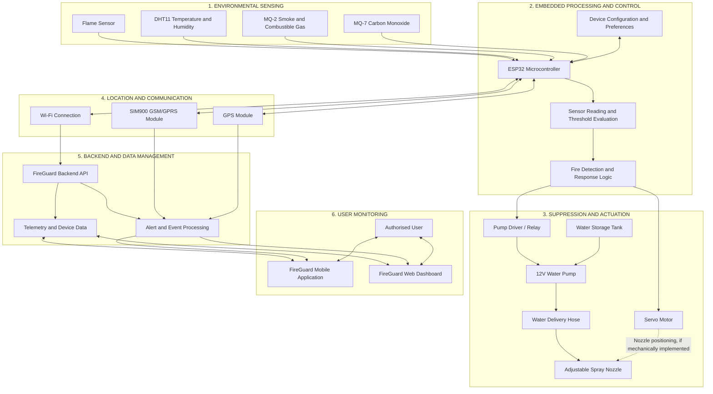

# FireGuard Capsule – Complete System Architecture

## 1. System Overview

FireGuard Capsule is an ESP32-based wildfire detection and automatic water-suppression prototype developed to identify potential fire threats, process sensor information and initiate a controlled response.

The system combines environmental sensors, a microcontroller, water-suppression hardware, GPS positioning, GSM communication, Wi-Fi connectivity, a backend server, a mobile application and a web dashboard.

The architecture is organised into six main layers:

1. Environmental sensing layer.
2. Embedded processing and control layer.
3. Automatic suppression and actuator layer.
4. Location and communication layer.
5. Backend and data management layer.
6. User monitoring and control layer.

## 2. Complete System Architecture Diagram

The following diagram illustrates the intended relationship between the hardware, communication infrastructure and software platforms.

**Architecture note:** The diagram represents the system design and intended data flow. It does not independently prove that every connection, dashboard command or mechanical arrangement has been physically implemented and tested.

## 3. Environmental Sensing Layer

The sensing layer collects information about environmental conditions that may indicate a fire threat.

| Component | Function | ESP32 GPIO |
|---|---|---:|
| Flame sensor | Detects flame-related infrared radiation | GPIO 18 (digital output) |
| DHT11 | Measures temperature and humidity | GPIO 19 |
| MQ-2 | Provides smoke and combustible-gas sensor readings | GPIO 34 (analog input) |
| MQ-7 | Provides carbon-monoxide sensor readings | GPIO 35 (analog input) |

The ESP32 receives the sensor readings and evaluates them using the configured detection logic.

The MQ-2 and MQ-7 are gas-sensing modules. Their readings must be calibrated and interpreted carefully. They do not independently provide laboratory-grade identification or measurement of a particular gas concentration.

## 4. Embedded Processing and Control Layer

The ESP32 is the central processing and control unit.

Its responsibilities include:

- Reading environmental sensor data.
- Evaluating configured detection thresholds.
- Processing the system's fire-response logic.
- Controlling the water-pump switching circuit.
- Controlling the servo motor.
- Receiving GPS information.
- Managing GSM and Wi-Fi communication.
- Sending available telemetry to the backend.
- Managing device configuration.

### 4.1 Firmware GPIO Allocation

| Function | GPIO |
|---|---:|
| Flame sensor digital output | 18 |
| DHT11 data | 19 |
| MQ-2 analog output | 34 |
| MQ-7 analog output | 35 |
| GPS serial communication | 32 / 33 |
| SIM900 serial communication | 16 / 17 |
| RGB indicator | 25 / 26 / 14 |
| Buzzer | 22 |
| Pump control signal | 27 |
| Servo signal | 13 |

These are the GPIO assignments used by the documented firmware configuration. Physical wiring must be checked against the actual prototype.

## 5. Automatic Suppression and Actuation Layer

The suppression subsystem is designed to deliver water when the controller activates the pump.

Its main components are:

- Water storage tank.
- 12V DC water pump.
- Pump driver or relay.
- Reinforced water-delivery hose.
- Adjustable spray nozzle.
- Servo motor for the intended mechanical positioning function.

### 5.1 Pump Operation

The ESP32 sends a control signal to a suitable pump driver or relay. The switching device controls the pump's power supply.

The pump must receive power from an appropriately rated external power circuit. It must never be powered directly from an ESP32 GPIO.

### 5.2 Servo Operation

The servo receives its control signal from GPIO 13 and is intended to provide mechanical movement within the suppression assembly.

Its actual mechanical function, torque capacity, mounting arrangement and movement range must be verified against the assembled prototype.

### 5.3 Suppression Safety

The system must include appropriate electrical protection, pressure-rated hydraulic components, secure water connections and a safe shutdown mechanism.

The pump should remain off when suppression is not required.

## 6. Location and Communication Layer

FireGuard uses GPS, GSM and Wi-Fi to support device location, emergency communication and remote monitoring.

### 6.1 GPS Module

The GPS module provides location information to the ESP32.

The documented firmware uses:

- GPS RX: GPIO 32.
- GPS TX: GPIO 33.

GPS information can support location reporting when a valid satellite fix is available.

### 6.2 GSM Module

The SIM900 module provides GSM communication and supports the intended emergency SMS functionality.

The documented serial assignments are:

- SIM900 RX: GPIO 16.
- SIM900 TX: GPIO 17.

Emergency notifications can include available GPS information and system status.

Successful SMS delivery depends on network coverage, SIM configuration, module power stability and service availability.

### 6.3 Wi-Fi Communication

The ESP32 uses Wi-Fi to communicate with the FireGuard backend.

The current backend deployment is:

`https://fireguard-backend-pxyf.onrender.com`

The documented telemetry endpoint is:

`/api/device/telemetry`

The complete endpoint and authentication requirements must follow the deployed backend API implementation.

## 7. Backend and Data Management Layer

The FireGuard backend provides the server-side communication layer between registered hardware devices and the software platforms.

Its documented responsibilities include:

- Receiving device telemetry.
- Processing device communication requests.
- Supporting capsule registration.
- Managing device authentication.
- Providing data to connected software features.

Documented API routes include:

| Endpoint | Purpose |
|---|---|
| `/api/device/telemetry` | Device telemetry |
| `/api/capsules/register` | Capsule registration |
| `/auth/login` | User authentication |

The backend is deployed separately from the ESP32 hardware. Its availability depends on hosting, network connectivity and server configuration.

## 8. User Monitoring and Control Layer

The user interface layer consists of the FireGuard mobile application and web dashboard.

These platforms are intended to provide users with access to system information and monitoring functions.

The software architecture supports the following intended functions:

- User authentication.
- Device and capsule information.
- Environmental telemetry monitoring.
- Fire-event information.
- Available GPS location information.
- Device status monitoring.
- Suppression-system status.

Any remote control function must be supported by the actual backend API and implemented firmware command handling. A displayed interface control must not be treated as proof that the hardware has successfully executed the command.

## 9. Main System Data Flow

The normal system information flow follows these stages:

1. Environmental sensors collect readings.
2. The ESP32 receives and processes the readings.
3. The firmware evaluates the configured detection conditions.
4. The controller manages indicators and the intended suppression response.
5. GPS information is collected when available.
6. The GSM module supports emergency SMS communication.
7. Wi-Fi supports communication with the FireGuard backend.
8. The backend makes supported device information available to the mobile application and web dashboard.

The exact order and timing of these operations depend on the firmware implementation and communication availability.

## 10. Electrical and Communication Interfaces

The architecture uses several different interfaces:

| Interface | Application |
|---|---|
| Digital GPIO | Flame sensor and control signals |
| Analog GPIO | MQ-2 and MQ-7 sensor readings |
| Serial UART | GPS and SIM900 communication |
| PWM / servo control signal | Servo motor positioning |
| Wi-Fi | ESP32-to-backend communication |
| HTTP API | Device and backend data exchange |
| GSM | Emergency SMS communication |

Electrical power requirements must be considered separately from communication connections.

The ESP32 uses 3.3V logic. Sensor outputs, motor supplies and communication-module power requirements must be checked against the actual component specifications. In particular, analog inputs must not receive voltages above the ESP32's permitted input range.

## 11. System Dependencies and Failure Considerations

The system depends on several hardware and communication conditions.

| Subsystem | Potential failure | Required consideration |
|---|---|---|
| Environmental sensors | Incorrect or unavailable readings | Sensor validation and calibration |
| ESP32 | Reset or power interruption | Stable power and fault handling |
| Pump circuit | Pump fails to activate | Driver protection and functional testing |
| Hydraulic system | Leakage or insufficient flow | Pressure and flow verification |
| Servo mechanism | Mechanical obstruction | Movement and load testing |
| GPS | No valid location fix | Location availability indication |
| GSM | SMS communication failure | Network and module checks |
| Wi-Fi | Backend communication interruption | Reconnection and offline handling |
| Backend | Service unavailable | Error handling and recovery |
| Mobile/web platform | Missing or delayed information | Data freshness and connection status |

## 12. Security and Reliability Considerations

The system should follow these security and reliability principles:

- Store private Wi-Fi credentials and device authentication tokens securely.
- Do not publish passwords, emergency phone numbers or device tokens in the repository.
- Use authenticated backend communication.
- Enable TLS certificate verification in production firmware.
- Validate commands before allowing hardware actuation.
- Apply appropriate electrical and hydraulic protection.
- Provide a safe response to communication loss and system faults.
- Record relevant system events for troubleshooting and evaluation.

The prototype firmware and backend must be reviewed together to confirm the actual security controls implemented.

## 13. Architecture Verification Status

The following table distinguishes documented design information from evidence that must still be collected.

| Architecture element | Current documentation status |
|---|---|
| ESP32-based controller | Documented in firmware |
| Sensor GPIO assignments | Documented in firmware |
| Pump control output | Documented in firmware |
| Servo control output | Documented in firmware |
| GPS serial interface | Documented in firmware |
| SIM900 serial interface | Documented in firmware |
| Wi-Fi telemetry integration | Documented in firmware and backend configuration |
| Backend API routes | Documented |
| Mobile application | Developed as a separate software component |
| Web dashboard | Developed as a separate software component |
| Physical wiring verification | Requires hardware inspection |
| Full end-to-end system verification | Requires integrated testing |
| Mechanical servo and nozzle arrangement | Requires physical verification |
| Complete suppression performance | Requires measured hydraulic testing |

## 14. Future Engineering Development

The architecture provides a foundation for further development, including:

- Improved sensor calibration and detection reliability.
- More robust communication recovery.
- Enhanced device monitoring and event history.
- Verified remote-control functionality.
- Improved mechanical positioning and water coverage.
- Battery and power-management optimisation.
- Hardware protection and environmental enclosure improvements.
- Automated testing and system performance evaluation.

Future features should be added only after their implementation and validation.

## 15. Conclusion

The FireGuard Capsule architecture integrates environmental sensing, embedded processing, automatic suppression hardware, location services, wireless communication and software-based monitoring.

The ESP32 serves as the central controller, while the backend provides the communication link between the hardware and the user-facing software platforms.

This architecture establishes a structured engineering foundation for continued prototype development, system integration, simulation and performance validation.

---

**Project:** FireGuard Capsule

**Discipline:** Embedded Systems, IoT, Mechanical Engineering and Software Integration

**Document:** Complete System Architecture

**Status:** Prototype architecture documentation – implementation and verification evidence maintained separately.
