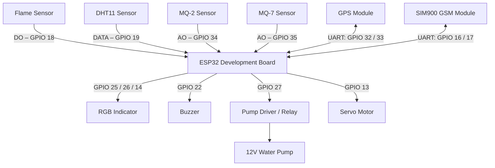

# FireGuard Capsule – Hardware Wiring and Pin Connections

## 1. Overview

This document describes the ESP32 GPIO assignments and electrical interfaces used by the FireGuard Capsule firmware.

The ESP32 acts as the main controller, receiving data from environmental sensors and communication modules while controlling the system indicators, buzzer, water-pump driver and servo motor.

## 2. Main Controller

| Item | Specification |
|---|---|
| Controller | ESP32 Development Board |
| Microcontroller | ESP32 |
| Operating logic voltage | 3.3V |
| Firmware file | `FireGuard_Capsule.ino` |

## 3. ESP32 Pin Assignment Table

| No. | Component | Component Pin | ESP32 GPIO |
|---|---|---|---|
| 1 | Flame Sensor | Digital Output (DO) | GPIO 18 |
| 2 | DHT11 | Data | GPIO 19 |
| 3 | MQ-2 | Analog Output (AO) | GPIO 34 |
| 4 | MQ-7 | Analog Output (AO) | GPIO 35 |
| 5 | GPS Module | TX | GPIO 32 (RX) |
| 6 | GPS Module | RX | GPIO 33 (TX) |
| 7 | SIM900 GSM | TX | GPIO 16 (RX) |
| 8 | SIM900 GSM | RX | GPIO 17 (TX) |
| 9 | RGB LED | Red | GPIO 25 |
| 10 | RGB LED | Green | GPIO 26 |
| 11 | RGB LED | Blue | GPIO 14 |
| 12 | Buzzer | Signal | GPIO 22 |
| 13 | Water Pump Driver | Control Input | GPIO 27 |
| 14 | Servo Motor | Signal | GPIO 13 |

## 4. Wiring Connections

### 4.1 Flame Detection Sensor

| Flame Sensor Pin | Connection |
|---|---|
| DO | ESP32 GPIO 18 |
| VCC | Compatible regulated power supply |
| GND | Common GND |

The firmware reads the digital output to determine whether a flame has been detected.

### 4.2 DHT11 Temperature and Humidity Sensor

| DHT11 Pin | Connection |
|---|---|
| DATA | ESP32 GPIO 19 |
| VCC | Compatible regulated power supply |
| GND | Common GND |

The sensor provides temperature and relative humidity readings.

### 4.3 MQ-2 Smoke and Gas Sensor

| MQ-2 Pin | Connection |
|---|---|
| AO | ESP32 GPIO 34 |
| VCC | Compatible regulated power supply |
| GND | Common GND |

The analog output is monitored by the ESP32.

### 4.4 MQ-7 Carbon Monoxide Sensor

| MQ-7 Pin | Connection |
|---|---|
| AO | ESP32 GPIO 35 |
| VCC | Compatible regulated power supply |
| GND | Common GND |

The analog output is monitored by the ESP32.

### 4.5 GPS Module

| GPS Pin | ESP32 Connection |
|---|---|
| TX | GPIO 32 (RX) |
| RX | GPIO 33 (TX) |
| VCC | According to module specifications |
| GND | Common GND |

The GPS module supplies location information through serial communication.

### 4.6 SIM900 GSM Module

| SIM900 Pin | ESP32 Connection |
|---|---|
| TX | GPIO 16 (RX) |
| RX | GPIO 17 (TX) |
| VCC | According to SIM900 board specifications |
| GND | Common GND |

The GSM module provides SMS communication for FireGuard alerts.

### 4.7 RGB Indicator

| RGB LED Channel | ESP32 GPIO |
|---|---|
| Red | GPIO 25 |
| Green | GPIO 26 |
| Blue | GPIO 14 |
| Common connection | According to LED type |

Use appropriate current-limiting resistors. The firmware is configured for a common-cathode RGB LED.

### 4.8 Buzzer

| Buzzer Connection | ESP32 |
|---|---|
| Signal | GPIO 22 |
| GND | Common GND |

Use a suitable driver circuit if the buzzer current exceeds the GPIO rating.

### 4.9 Water Pump Control

| Connection | Destination |
|---|---|
| Control input | ESP32 GPIO 27 |
| Driver power | Suitable external supply |
| Pump terminals | Pump driver output |
| Ground | Common reference where required by the driver |

The pump must be controlled through a suitable relay or motor-driver circuit. Never connect the pump directly to an ESP32 GPIO pin.

### 4.10 Servo Motor

| Servo Connection | Destination |
|---|---|
| Signal | ESP32 GPIO 13 |
| Power | Separate supply suitable for the servo |
| GND | Common ground with ESP32 |

The firmware controls the servo position through GPIO 13.

## 5. System Connection Diagram

This is a functional connection diagram. It identifies the firmware signal connections and is not a substitute for a detailed physical wiring schematic.

## 6. Power and Electrical Safety

1. Supply the ESP32 using a suitable regulated power source.
2. Check the operating voltage of every sensor and module against its manufacturer's specifications.
3. ESP32 GPIO pins operate at 3.3V logic. Protect analog inputs from voltages above the ESP32 input limits.
4. Use suitable voltage regulation or level shifting where required.
5. Provide an adequately rated external power supply for the SIM900 module.
6. Use a suitable external driver for the water pump.
7. Supply the servo using a power source suitable for its voltage and current requirements.
8. Connect grounds appropriately when using separate power supplies and signal interfaces.
9. Disconnect power before changing wiring.
10. Protect electronic components from water and moisture.

## 7. Firmware Configuration

The following firmware settings define the pin assignments and operating thresholds:

| Setting | Firmware Value |
|---|---:|
| MQ-2 threshold | 1800 |
| MQ-7 threshold | 1800 |
| High-temperature threshold | 35°C |
| Low-humidity threshold | 30% |
| Sensor reading interval | 2,500 ms |
| Telemetry upload interval | 15,000 ms |
| GPS baud rate | 9,600 |
| SIM900 baud rate | 9,600 |

These are firmware configuration values, not certified fire-detection limits.

## 8. Important Operating Notes

- The flame sensor's active output level must match the actual sensor module configuration.
- The pump is disabled by default when the firmware starts.
- The pump can be enabled or disabled through the local dashboard.
- The pump operates only when it is enabled and the firmware detects a flame.
- The servo moves in response to flame detection.
- SMS alerts depend on successful GSM network communication.
- Online telemetry requires an active Wi-Fi connection and a working backend.

## 9. Technical Reference

The pin assignments in this document are taken from the FireGuard Capsule ESP32 firmware.

Before powering the complete assembly, check the physical connections, module voltage requirements, driver ratings and actual sensor output logic against this document.

**Safety notice:** FireGuard Capsule is a prototype system. It must not be treated as a certified fire-protection or life-safety device.
